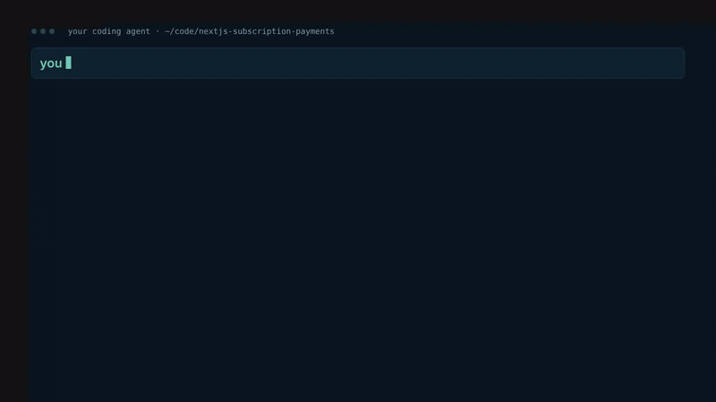
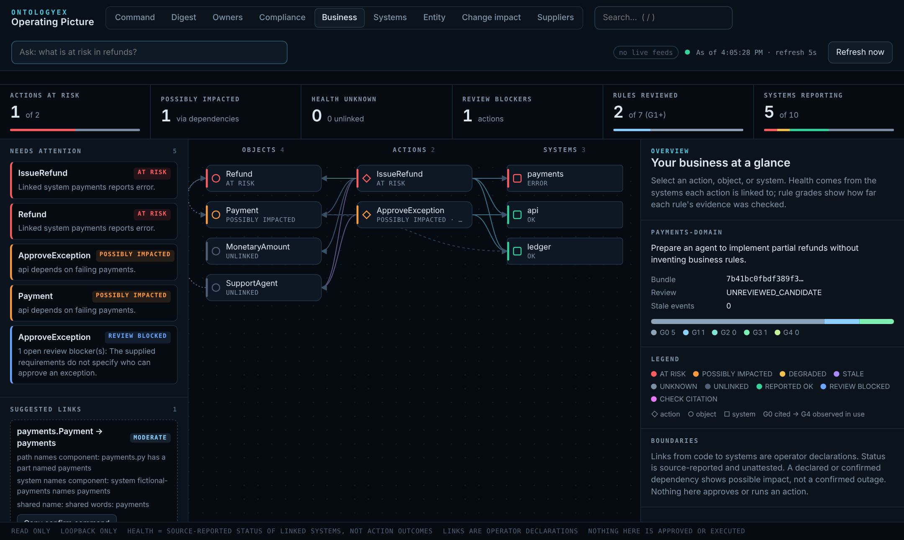
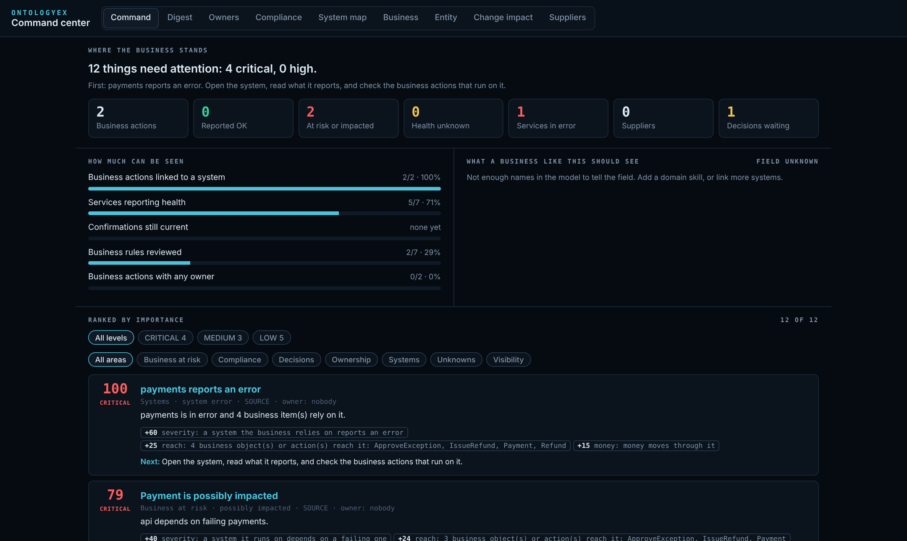
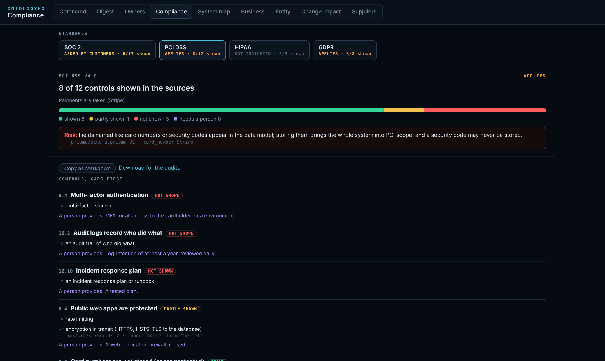
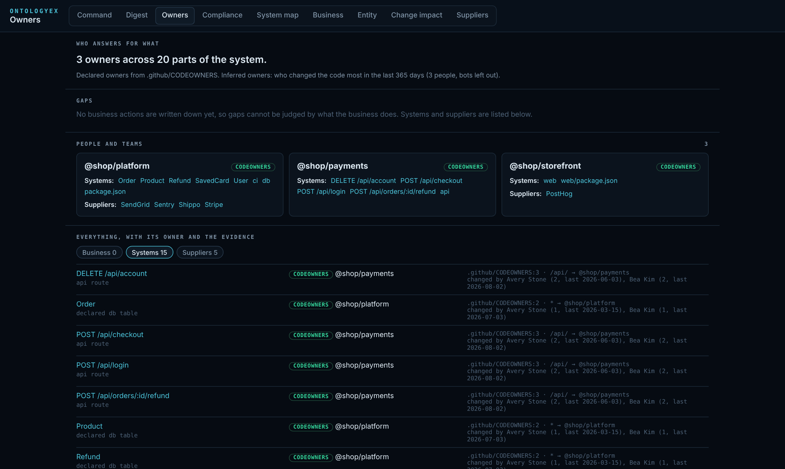
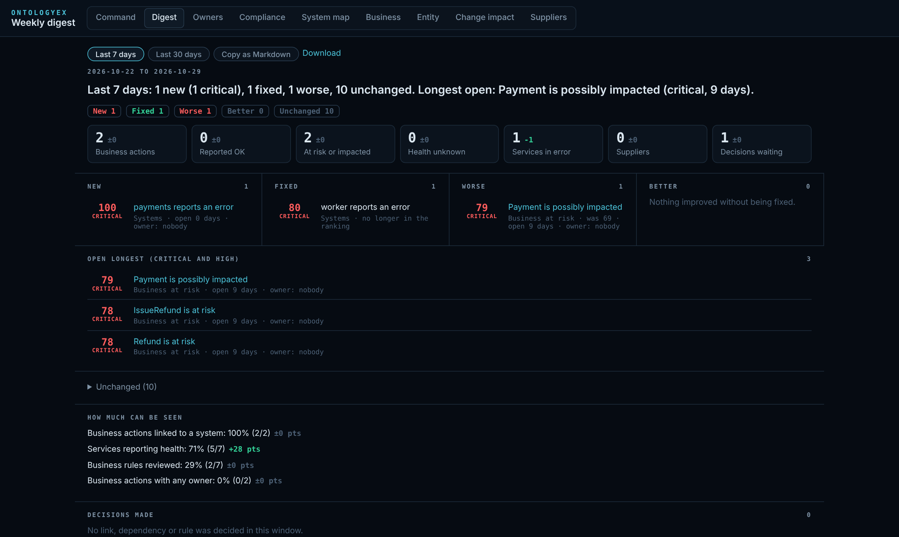
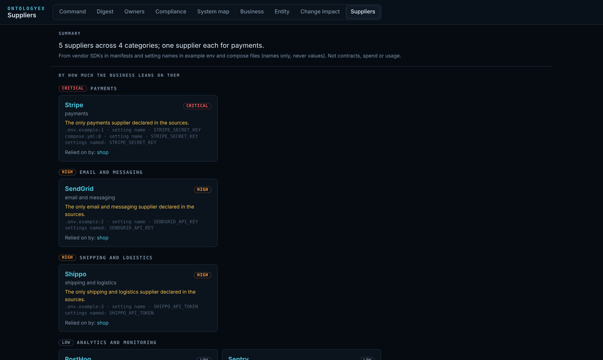
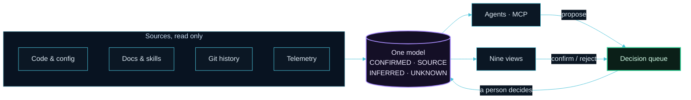

<div align="center">



**Point an agent at a repository. Get back the business it runs:**<br>
**who it serves, how money moves, what is breaking, who owns it, what an auditor will ask,<br>
and what changed this week. Every claim linked to the line it rests on.**

[](https://github.com/New1Direction/OntologyEX/actions/workflows/validator.yml)
[](https://github.com/New1Direction/OntologyEX/actions/workflows/rust-proof-foundation.yml)
[](docs/business-verification.md)
[](docs/rust-engine.md)
[](LICENSE)

**[Live example](https://new1direction.github.io/OntologyEX/docs/examples/nextjs-subscription-payments.html)** ·
**[Give it to your agent](#-give-it-to-your-agent)** ·
**[The control room](#-the-control-room)** ·
**[How it stays honest](#-how-it-stays-honest)** ·
**[Verified four ways](#-verified-four-ways)** ·
**[The engine](#-the-engine)**

</div>

---

## ◢ Give it to your agent

In Claude Code, Codex, Cursor or any coding agent, open your project and say:

> Use https://github.com/New1Direction/OntologyEX to give me an overview of this repository and the business behind it.

That is the whole interface. Your agent clones the kit, reads your repository (it never runs
it, never installs its dependencies, never sends it anywhere) and writes **one offline page**:
what the business is, who it serves, how money moves, the main journeys, where it breaks, and
what nobody wrote down. Each claim is linked to the lines it rests on, so you can check every one.
The agent's manual is [AGENTS.md](AGENTS.md).

[](https://new1direction.github.io/OntologyEX/docs/examples/nextjs-subscription-payments.html)

Written by agents from public repositories, every claim pinned to a commit:
[Vercel's Next.js subscription starter](https://new1direction.github.io/OntologyEX/docs/examples/nextjs-subscription-payments.html) (Stripe + Supabase SaaS) ·
[Saleor](https://new1direction.github.io/OntologyEX/docs/examples/saleor.html) (open-source commerce, payments through apps over webhooks).
Fresh agents have run it on Go, Next.js, Remix, Django, Rails, FastAPI, Laravel and Spring apps,
a 7,700-file monorepo, and a company handbook with no code at all.

## ◢ The control room

```bash
python ontology-extraction/scripts/operate.py up --repo /path/to/your/repo
```

One command, on your machine. Loopback only, read-only, nothing deployed. Nine views over a
single model of your business, the same model your agents read:

<table>
<tr>
<td width="50%"><a href="docs/media/control-room-business.png"></a><br><sub><b>Business</b>: actions and objects joined to the systems they run on, health flowing through the links.</sub></td>
<td width="50%"><a href="docs/media/control-room-command.png"></a><br><sub><b>Command</b>: everything that needs attention, ranked 0–100 by named factors, each with a next step and an owner.</sub></td>
</tr>
<tr>
<td><a href="docs/media/control-room-compliance.png"></a><br><sub><b>Compliance</b>: SOC 2, PCI DSS, HIPAA, GDPR, control by control, evidence cited by line.</sub></td>
<td><a href="docs/media/control-room-owners.png"></a><br><sub><b>Owners</b>: who answers for each action, system and supplier, and where nobody does.</sub></td>
</tr>
<tr>
<td><a href="docs/media/control-room-digest.png"></a><br><sub><b>Digest</b>: what moved since last week, who decided what, and the code that shipped.</sub></td>
<td><a href="docs/media/control-room-suppliers.png"></a><br><sub><b>Suppliers</b>: the outside companies you run on, and the ones with no second provider.</sub></td>
</tr>
</table>

| View | What it answers |
|---|---|
| **`/command`** | Everything that needs attention, big or small, ranked by importance. Every score is the sum of factors you can read and argue with (how bad, how much of the business reaches it, whether money moves through it), with the next step and the owner to call. Every finding names its evidence (what was observed, where, when, whether it is still current) and what would refute it; a conclusion on expired evidence reads unknown, and the systems verdict is never "healthy" while something is silent. Saved moments can be replayed to check the conclusions against what really happened. [How](docs/replay.md). |
| **`/digest`** | What moved since last week: new, fixed, worse, better, *fixed then back*, open longest. Who decided what. The code that shipped and the business it touched. One click to Markdown. |
| **`/business`** | Your domain skills joined to your live systems: which business actions are at risk, which depend on a failing system, which rules were checked and how far. |
| **`/owners`** | Who answers for each part: declared in CODEOWNERS (line cited) or inferred from a year of git history. Business actions nobody owns. Code only one person knows. |
| **`/compliance`** | SOC 2, PCI DSS v4.0, HIPAA and GDPR mapped to what the code shows, with the lines cited, and what only a person can provide. An evidence map for preparing an audit, not an audit. |
| **`/operations`** | What the business actually does, from its own records: payments, refunds, disputes, payouts, subscriptions and invoices by week; bank and card lines, bills and cloud costs by month; support tickets and sales deals by week (aggregates only, never a row, a customer, a ticket's subject or a person paid); policies, terms and contracts read for their promises, each held to the records; payouts checked against the bank, suppliers paid against suppliers the code uses, refunds against refund tickets, documents that disagree, and what happens that nobody wrote down. Read-only pulls from Stripe, AWS, Zendesk and HubSpot can run on a schedule (`up --pulls`), and a pull that fails or falls behind says so. [How](docs/operations.md). |
| **`/suppliers`** | The outside companies you run on (payments, sign-in, email, cloud, AI, shipping, tax…), how critical each kind is, where only one is declared, and what relies on each. |
| **`/impact`** | Before a merge: what a branch touches in the business, and everything that relies on it. |
| **`/entity`** | Any object, action, system or supplier: why it exists, what a person confirmed and what is only inferred, what relies on it, the files behind every link, and whether the code it was modeled from is still there (moved, changed or gone; [source drift](docs/drift.md)). |
| **`/`** | The system map: services, routes, tables and calls, with live health from OpenTelemetry traces, Prometheus and health checks. |

**Readout from the bundled demo** (synthetic data; real output of the tools):

```text
ONTOLOGYEX // COMMAND CENTER                                12 items · 4 critical
─────────────────────────────────────────────────────────────────────────────────
 100  CRITICAL  payments reports an error
  79  CRITICAL  Payment is possibly impacted
  78  CRITICAL  IssueRefund is at risk
  78  CRITICAL  Refund is at risk
  48  MEDIUM    ApproveException is possibly impacted
  43  MEDIUM    Nobody owns IssueRefund
─────────────────────────────────────────────────────────────────────────────────
DIGEST  Last 7 days: 1 new (1 critical), 1 fixed, 1 worse, 10 unchanged.
        Longest open: Payment is possibly impacted (critical, 9 days).
```

See it in ten seconds, no setup beyond Python 3.11 and PyYAML:

```bash
python examples/operating-picture/demo.py --serve   # then open http://127.0.0.1:8765/command
```

Live health is real telemetry: `feed_setup.py propose` lists the health checks your compose files
declare, `otel_setup.py run --service web -- npm start` adds OpenTelemetry traces to a Node or
Python service with no code change, and calls your repository never declared show up as suggested
dependencies. See [operating picture](ontology-extraction/references/operating-picture.md) and [live feeds](docs/live-feeds.md).

## ◢ Agents get the same model, and cannot change it

```bash
python ontology-extraction/scripts/agent_tools.py serve --control-room http://127.0.0.1:8765 \
  --agent claude --operator "Your Name" --audit audit.jsonl
```

An MCP server over the running control room. **Fifteen read tools**: `what_needs_attention`,
`weekly_digest`, `who_owns`, `compliance_status`, `operations_status`, `list_suppliers`, `analyze_change`,
`analyze_impact`, `get_entity_context`, `explain_relationship`, `search_entities`,
`list_suggestions`, `list_stale_decisions`, `source_drift`, `recent_changes`. **Three propose tools**:
`propose_link`, `propose_dependency` and `propose_rule` append a suggestion that a person
confirms or rejects. There is no destructive tool, and the server refuses to register one. Every
agent runs under its own policy (tools allowed, files and entities withheld), and every call is
audited. See [entity context](ontology-extraction/references/entity-context.md).

The rules hold agents' own tools too: `guardrail.py install` adds a Claude Code hook that checks each
call of a tool you map to a business task against that task's rules before it runs. A broken rule is
denied with the rule named; an open question, a missing input or code that changed under the rules
goes to a person; a pass is no decision, never an approval. A call that timed out or was interrupted has
an unknown outcome, so the identical next call waits until someone checks the live state, instead of refunding
twice. See [guardrails](docs/guardrails.md).

## ◢ How it stays honest



- **Four standings, weakest link wins.** Everything is CONFIRMED (a person decided), SOURCE
  (declared in a file), INFERRED (suggested) or UNKNOWN, and a path through the model is only
  as strong as its weakest hop.
- **Decisions remember their evidence.** A confirmation records the hashes of the files it
  rested on. Change one and the link drops to INFERRED until a person re-confirms it.
- **Stale views are refused.** A decision carries the fingerprint of what the page showed;
  if anything changed between looking and clicking, nothing is written and the page says why.
- **Background scans are kept only if the repository held still** while they read it.
- **`execution_authorized: false`** on every answer. Nothing here approves, runs or deploys.
- **Secrets stay unread.** `.env` files, keys and credentials are never opened; a line that sets
  a key is cited without its text.

## ◢ Verified four ways

| Layer | What it guarantees |
|---|---|
| **Golden fixtures** | 18 pinned outputs on a demo, a shop and a clinic with fixed git histories. Any change to an answer fails CI with the JSON paths that moved, and an intended change must be recorded with its reason. |
| **Rust ≡ Python** | Differential parity on every change: 2,557 entity-context cases, 5,049 discovery cases, 2,840 live-feed cases, 3,000 decision batches, zero mismatches allowed. |
| **Lean 4 + Bend** | 122 theorems over the health rollup, grade ladder, link decisions, the decision queue, change impact, impact standing, decision batches and their undo, watermarks and stale views. Trusted statements live apart from the proofs and are pinned by hash. Lean prints its tables and CI compares them row by row with Python (1,111 rollup rows, 341 path rows, 300 impact graphs, 300 decision batches…). |
| **780+ tests** | Python 3.11 and 3.13, headless-browser smoke tests, every page script parsed, the installed kit exercised from an unrelated directory. No API keys, no model calls. |

Details: [business verification](docs/business-verification.md) · [golden fixture changes](tests/golden/CHANGES.md).

## ◢ The engine

An optional Rust engine runs the hot paths with the same answers, checked by CI on every change.
Time, CPU and correctness are measured apart, and a speed-up counts only when the answers match:

<!-- benchmark:begin (generated by tests/bench_rust_engines.py --write-docs) -->
| Job | Python | Rust | |
|---|---|---|---|
| Discovery of a 5,900-file repository with 125 manifests | 1.54 s | 87.6 ms | **17.6× faster**, 17.8× less CPU |
| OTLP trace ingest, 4 client processes, 1,000 spans per request | 66,941 spans/s | 2,318,115 spans/s | **34.6× more** |
| OTLP receiver peak memory under that load | 45.9 MiB | 11.2 MiB | 4.1× less |
| Entity context for all 16 demo entities, as the control room asks | 2.1 ms | 81.6 ms | 40.0× slower |

Generated from [docs/benchmarks/latest.md](docs/benchmarks/latest.md): release builds on Intel(R) Xeon(R) Processor @ 2.80GHz, 4 usable CPUs, 2026-10-29, commit 1745e81. Answers compared on 3 of 3 workloads: the same. Your numbers will differ; the answers should not.
<!-- benchmark:end -->

With background scans, the slowest page answer after the first load on a real repository
(documenso: about 3,000 files, 720 commits in a year) fell from **4.2 s to 0.19 s**.
With the engine, Python, JavaScript/TypeScript and Go are read from syntax trees (tree-sitter) instead of
patterns: no routes from comments or docstrings, and each router's own prefix followed
([code surfaces](docs/code-surfaces.md#syntax-trees)).
Install prebuilt binaries with `python ontology-extraction/scripts/fetch_engine.py`. See [Rust engine](docs/rust-engine.md).

## ◢ Domain skills: change a workflow without inventing rules

Before an agent changes a workflow, give it a **domain skill**: the business concepts, actions and
rules of that workflow, each bound to the code that implements it and the evidence it rests on,
with the unknowns and conflicts kept visible instead of guessed away.

```bash
python ontology-extraction/scripts/install.py --project /path/to/your-project
```

```text
/ontology-extraction Onboard the reservation and cancellation workflow in this repository.
Propose the smallest useful source set. After I acknowledge it, build a reusable domain
skill for modifying that workflow. Show the rules, implementation locations, evidence,
and anything the sources leave unclear.
```

The installer copies the kit into `.claude/skills/ontology-extraction`; it refuses overwrites,
changes no global settings and pre-approves no tools. Authoring is bounded (one submission and at
most two corrections), evidence spans are copied exactly with their hashes (`evidence.py`), and
nothing is approved, promoted or deployed by a command.

- **[Guided onboarding](ontology-extraction/references/guided-onboarding.md)** and the **[contract](ontology-extraction/references/domain-skill.md)**.
- **[Real-source case](examples/cachetools-domain/README.md)**: pinned `cachetools` source, a compiled skill, 18 behavioral checks against the real library, no API key.
- **[Native-agent pilot](docs/native-pilot.md)**: run it in a fresh agent session and grade the result.
- **[Evidence grades](ontology-extraction/references/evidence-grades.md)** G0–G4, **[rule wording](ontology-extraction/references/rule-wording.md)** checks, **[RDF / SPARQL](docs/rdf-interop.md)** export, **[decision models](docs/decision-models.md)**, the **[four-layer method](ontology-extraction/METHOD.md)**, and experimental **[traces → ontology](ontology-extraction/references/trace-to-ontology.md)**.

## ◢ Boundaries

Checks are not permissions. `CHECKS_PASS` describes modeled conditions on supplied inputs;
unknown conditions produce `NEEDS_REVIEW`. Health is the source-reported status of linked
systems, not proof that an action works. Owners inferred from git history are history, not
accountability. The compliance map is evidence for preparing an audit, not an audit. Source
hashes establish byte identity, not semantic truth. Source text is untrusted data, and secret-name
filtering is not an exhaustive secret scanner. The consuming application owns authorization,
state, concurrency and integration safety.

## ◢ Build on it

```bash
python -m pip install 'PyYAML==6.0.3'
python -m unittest discover -s tests            # the suite, including golden fixtures
python tests/golden.py check                     # just the pinned answers
cargo test --locked --manifest-path engine/Cargo.toml
```

A change meant to alter an answer is made with `python tests/golden.py update --reason "why"`.
Useful contributions: a scoped real-source example, a failing behavioral case, or a documented
fresh-agent run with comparable baselines. Working on the kit itself: see the end of [AGENTS.md](AGENTS.md).

## License

[MIT](LICENSE) © 2026 New1Direction. The optional cachetools case preserves upstream MIT attribution
and verifies the upstream files against the pinned commit listed in its provenance manifest.
