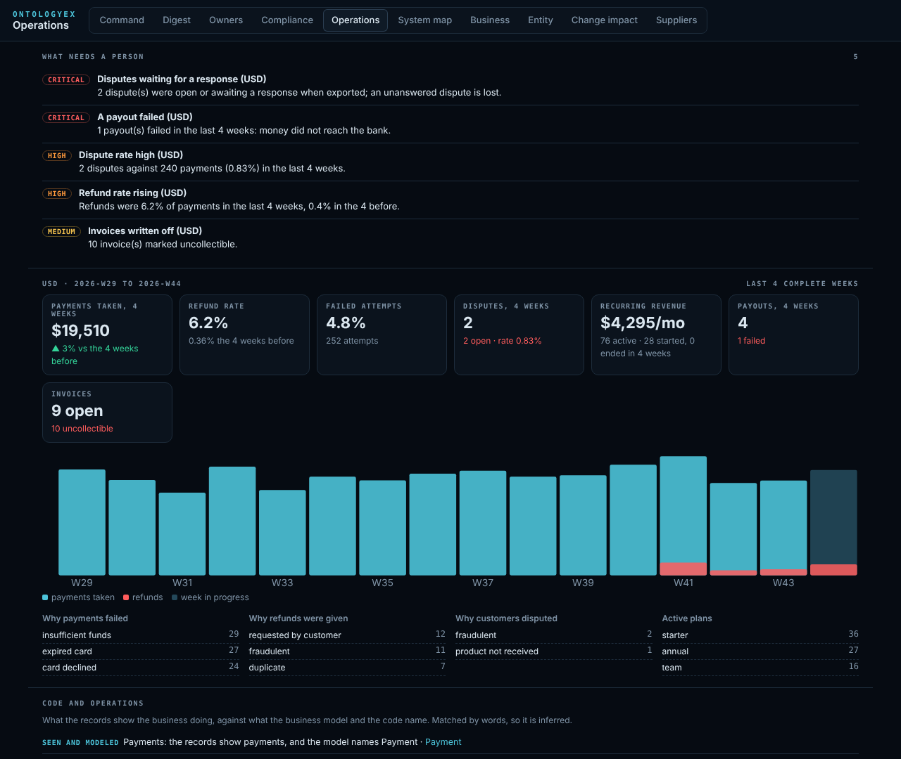
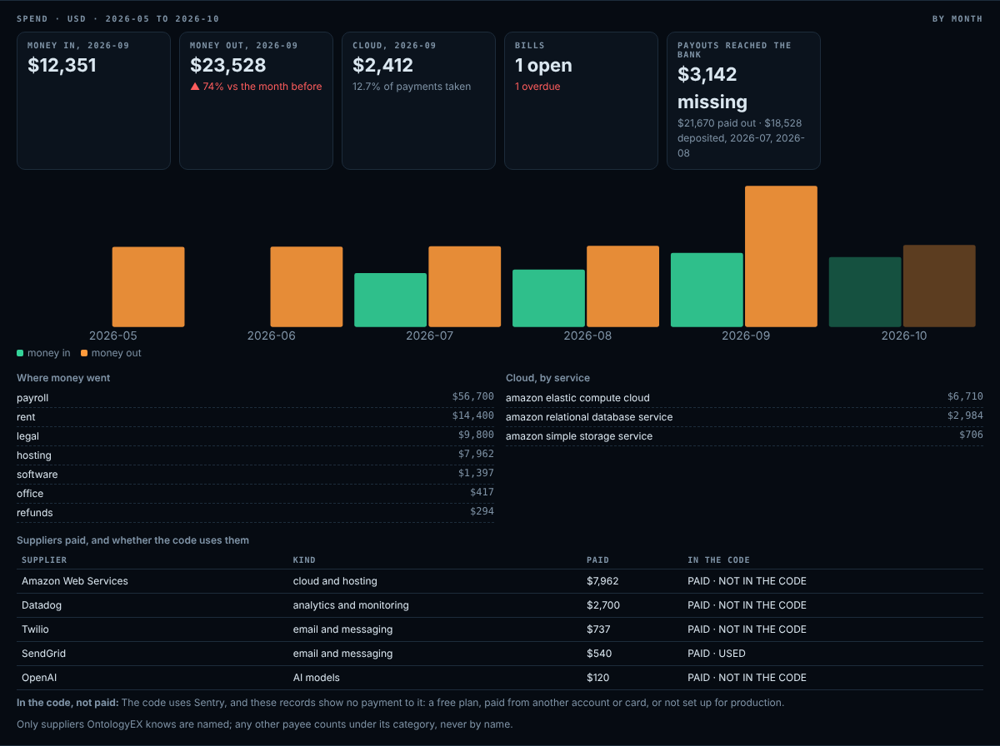
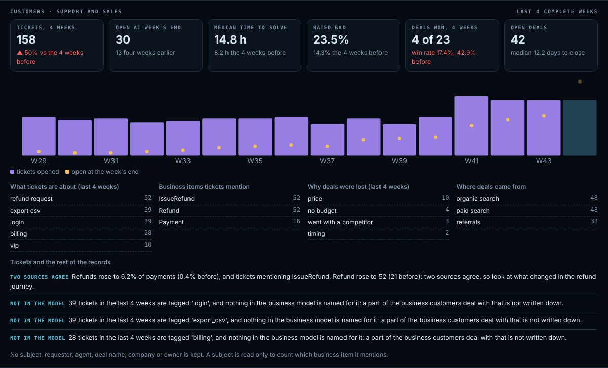
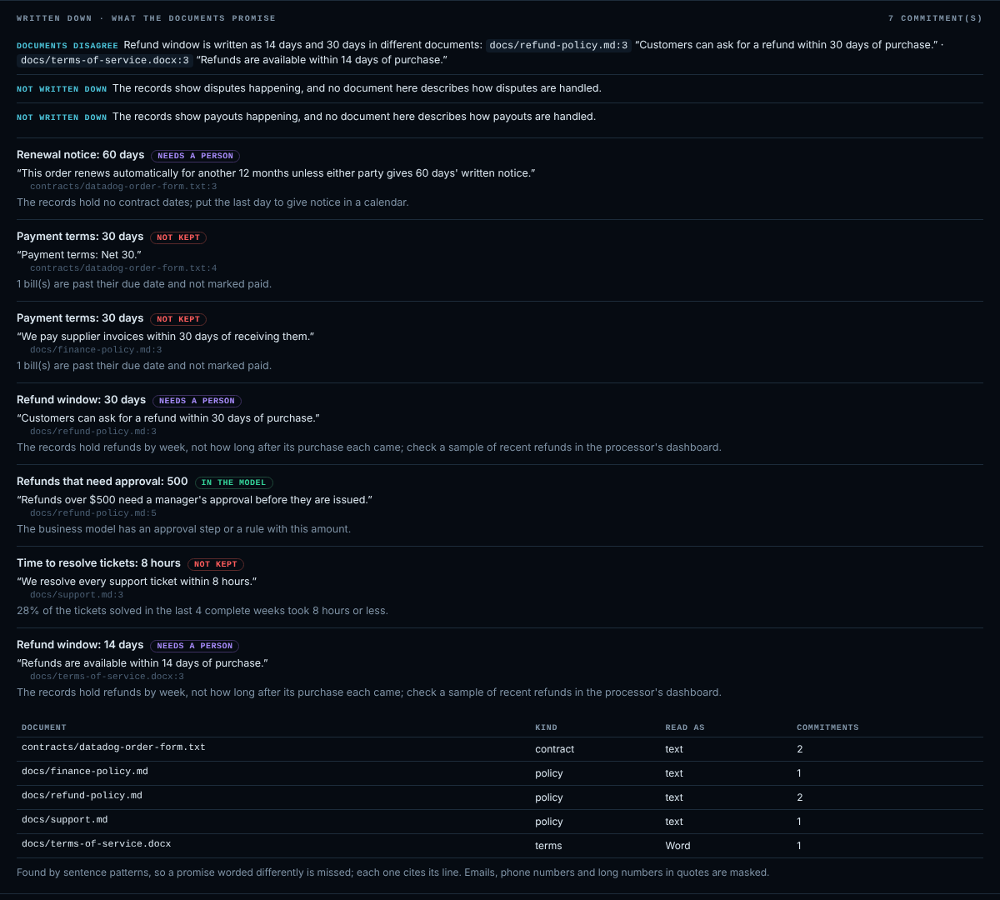

# Operations: what the business actually does

The code says what a business *can* do. Its records say what it *does*: the payments it
takes, the refunds it gives, the disputes it fights, the payouts that reach the bank, the
subscriptions that start and end, the invoices that go unpaid. OntologyEX reads those
records and keeps **weekly aggregates per currency only**. No row, customer or identifier is
ever kept or shown.



Open `/operations` in the control room (`operate.py up`, or `control_room.py --repo REPO`).
The **command center** ranks what needs a person (Operations category). Agents ask through
`operations_status`.

## Give it the records

Drop exports in `REPO/.ontologyex/operations/` (or pass `--operations DIR`). The page picks up a
new or changed file on its next refresh.

| Records | Read from |
|---|---|
| Payments, refunds, disputes, payouts, subscriptions, invoices | Stripe dashboard exports (CSV), recognized by file name and columns |
| The same, as API objects | Stripe API lists saved as JSON (`{"object": "list", "data": [...]}`) |
| Another processor (PayPal, Paddle, Square, …) | its CSV export, described once in `operations.json` |
| A live account | a read-only pull that writes aggregates only (below) |

`operations.json` in the same folder describes a file the columns do not identify:

```json
{"files": [{"match": "paypal*.csv", "stream": "payments", "date_format": "%m/%d/%Y",
            "columns": {"amount": "Gross", "currency": "Currency", "created": "Date",
                        "status": "Status", "fee": "Fee"},
            "status_map": {"Completed": "succeeded", "Denied": "failed"}}]}
```

A file that is not recognized is listed with its column names (never its values) and what to
add. A file whose dates or currencies cannot be read says how many rows were not counted.

### Pull with a read-only key

```bash
STRIPE_API_KEY=rk_live_... python ontology-extraction/scripts/operations.py pull stripe \
  --out REPO/.ontologyex/operations --days 180
```

- **Restricted key only.** Create a restricted key in the Stripe dashboard with **read**
  access to charges, refunds, disputes, payouts, subscriptions and invoices. A secret key
  (`sk_…`) can change the account, so it is refused unless you pass `--allow-secret-key`.
- **Aggregates only.** Each page is aggregated as it arrives and discarded; the only file
  written is `stripe-api.ontologyex-aggregate.json`, with no IDs, emails or rows.
- **One answer per week.** Where a pull and an export cover the same week, the pull is kept and
  the overlap is reported.
- **It goes over the network**, so an agent asks before running it.

### Keep it current: live pulls

Declare the pulls once, in `pulls.json` in the operations folder, and they run on their own
intervals while the control room is up:

```json
{"pulls": [
  {"provider": "stripe", "every_minutes": 60, "days": 180},
  {"provider": "aws", "every_minutes": 360, "months": 6, "profile": "billing-read"},
  {"provider": "zendesk", "subdomain": "acme", "every_minutes": 60, "days": 120},
  {"provider": "hubspot", "every_minutes": 120}
]}
```

```bash
STRIPE_API_KEY=rk_live_... python ontology-extraction/scripts/operate.py up --repo REPO --pulls
# or once, from cron:
STRIPE_API_KEY=rk_live_... python ontology-extraction/scripts/operations.py pull all --dir REPO/.ontologyex/operations
```

- **Same pulls, same rules.** Each runs the `operations.py pull` above: read-only, aggregates
  only, a secret Stripe key refused.
- **Keys from the environment only.** The file names an environment variable (`key_env`; by
  default `STRIPE_API_KEY`, `HUBSPOT_TOKEN`, and `ZENDESK_OAUTH_TOKEN` or `ZENDESK_EMAIL` and
  `ZENDESK_API_TOKEN`), never a key: a field holding a key is refused, and an error that echoes a
  key has it masked. AWS uses the `aws` command line's own credentials, with `profile` if given.
- **Nothing runs unless asked.** Without `--pulls` (or the cron line) nothing goes over the
  network. Intervals are 15 minutes to a week, and each pull runs at most once per interval.
- **Its state is on the page.** `pulls.status.json` beside it records, for each pull, when it last
  ran and succeeded, what it read (counts) and when it runs next. The Operations page shows it
  under *Live sources*, and the command center raises `PULL_FAILING` (the last run failed, with
  the masked error), `PULL_STALE` (no success for two intervals: the figures are getting old) and
  `PULLS_MISCONFIGURED` (the file cannot be used, and says why).
- `api_base` exists for tests and may only point at this machine.

### Spend: bank, card, bills and cloud

The same folder takes where the money goes, kept as **monthly** aggregates:

| Records | Read from | Kept |
|---|---|---|
| Bank, card or ledger lines | any statement CSV with a date, an amount (or debit and credit) and a description, payee or category | money in and out, out by category, by known supplier, and deposits from payment processors |
| Vendor bills | a CSV with bill date, vendor, amount and due date or status | billed, open and overdue, by known supplier |
| Cloud costs | AWS cost and usage reports, Google Cloud billing exports, Azure cost exports | cost by provider and service |

- **Supplier names.** A supplier is named only when the payee or description names one
  OntologyEX knows: the catalog the supplier map uses, with the forms banks print, like
  `AWS EMEA` or `GOOGLE *CLOUD`. Any other payee is counted under its category and never named:
  a person on payroll, a shop, or a customer refunded. Names too common to tell apart from a shop
  or a word (Square, Segment, Neon and a few others) are not matched in bank lines.
- **Bank exports need a currency.** Most have no currency column, so give the file one in
  `operations.json`. Card exports often list charges as positive amounts; add
  `"amounts": "out_positive"` for those.
- **Pull from AWS** with the `aws` command line and the credentials it is already set up with.
  `ce:GetCostAndUsage` is read-only, though AWS charges a small fee per request:

  ```bash
  python ontology-extraction/scripts/operations.py pull aws --out REPO/.ontologyex/operations --months 6
  ```



What spend adds:
- **Suppliers paid against suppliers used.** The bank and bills are compared with the supplier map
  from the code:
  - *paid, not in the code*: a tool people use, a service set up outside the repository, or one
    nobody needs any more;
  - *in the code, not paid*: a free plan, paid from another account or card, or not set up for
    production;
  - payment processors are left out of both, since their fees come out of payouts.
- **Payouts against the bank.** Processor payouts, by the month they landed, are compared with
  deposits from payment processors in the bank lines, over the months both cover except the last.
  It is rough, since a payout can land a few days later.
- **Cloud against what comes in.** The last complete month's cloud cost as a share of payments
  taken.
- **Signals:**

| Signal | When |
|---|---|
| `PAYOUTS_NOT_IN_BANK` | payouts exceed processor deposits by more than 2% (and 50) |
| `DEPOSITS_WITHOUT_PAYOUTS` | processor deposits exceed payouts by that much |
| `BILLS_OVERDUE` | a bill is past its due date and not marked paid |
| `SPEND_RISING` | money out in the last complete month is over 1.3 times the three months before |
| `CLOUD_COST_RISING` | cloud costs in the last complete month are over 1.25 times the month before, and up by 100 or more |
| `NEW_SUPPLIER_PAID` | a known supplier was paid for the first time in the last complete month |

Cloud costs describe services, not people, so they are never withheld. Bank lines and bills
follow the small-count rule below.

### Customers: support and sales

Helpdesk and CRM exports in the same folder, kept as **weekly** aggregates:

| Records | Read from | Kept |
|---|---|---|
| Support tickets | Zendesk, Freshdesk, Intercom, Help Scout or any helpdesk export with a created time and status | opened, solved, the backlog open at each week's end, time to solve, topics (the helpdesk's tags, else its type), priority, channel, good and bad ratings, and how many tickets mention each business item |
| Sales deals | HubSpot, Salesforce or any CRM export with a stage and a created date | created, won, lost, amounts per currency, win rate, days to close, why deals were lost, where they came from, open deals |

- **What is never kept:** a ticket's subject or body, a requester, an agent, a deal's name, its
  company or its owner.
- **Subjects are only matched.** A subject is read for one thing, whether it names an item of the
  business model (`Refund`, `IssueRefund`, `Payment`), so tickets count against the business.
  The subject itself is dropped.
- **Durations go into fixed buckets.** Time to solve and days to close are counted into buckets,
  never as one number per ticket or deal; medians are read from the buckets.
- **Pulls** (read-only, aggregates only):

  ```bash
  ZENDESK_OAUTH_TOKEN=... python ontology-extraction/scripts/operations.py pull zendesk --subdomain acme --out DIR --days 120
  HUBSPOT_TOKEN=pat-... python ontology-extraction/scripts/operations.py pull hubspot --out DIR
  ```

  - **Zendesk:** an OAuth token with the read scope (or `ZENDESK_EMAIL` and `ZENDESK_API_TOKEN`;
    API tokens can also write, so OAuth with read is safer). It follows the next page only on the
    same Zendesk host.
  - **HubSpot:** a private app token with `crm.objects.deals.read`. Won and lost come from each
    pipeline's stage metadata.
  - A pull outside the control room does not know the business items, so it counts no mentions;
    exports read by the control room do.



**Signals:** `TICKETS_RISING`, `BACKLOG_GROWING`, `RESOLUTION_SLOWER`, `SATISFACTION_DROPPING`,
`TOPIC_SPIKE`, `WIN_RATE_DOWN`, `LOSS_REASON_DOMINANT`.

**With the rest of the records:**
- **Two sources agree** when refunds rose in the payment records and tickets mentioning refunds
  rose too. That ranks above either signal alone.
- **Not in the model** names a topic customers keep raising (10 or more tickets in four weeks) that
  nothing in the business model is named for.

### Written down: what the documents promise

Put policies, procedures, terms and contracts in the same folder: Markdown, text, HTML, Word (`.docx`) or
simple PDF files. Scanned or unusually encoded PDFs give no text; save them as text instead.



They are read for commitments a business can keep or break, each cited to its file and line:

| Commitment | Written like | Held to |
|---|---|---|
| `REFUND_WINDOW` | "a refund within 30 days", "30-day money-back guarantee" | needs a person: the records hold refunds by week, not each one's age |
| `REFUND_APPROVAL` | "refunds over $500 need a manager's approval" | the business model: is there an approval step or a rule with that amount |
| `RESOLUTION_TIME` | "we resolve every ticket within 8 hours" | the share of tickets solved within that time in the last four weeks (kept at 90% or more) |
| `DISPUTE_RESPONSE` | "we respond to chargebacks within 7 days" | the disputes open when exported (a person checks their deadlines) |
| `PAYMENT_TERMS` | "net 30", "we pay supplier invoices within 30 days" | bills past their due date |
| `RENEWAL_NOTICE` | "renews automatically unless 60 days' written notice" | needs a person: put the notice date in a calendar |
| `UPTIME` | "99.9% uptime" | needs a person: health feeds report status, not measured availability |

- **Documents disagree** when two documents state different values for the same commitment (say,
  a refund window of 14 days in the terms and 30 in the refund policy).
- **Not written down** when the records show refunds, disputes, payouts or support happening and
  no document describes how they are handled.
- **Signals:** `WRITTEN_PROMISE_NOT_KEPT`, `WRITTEN_RULES_CONFLICT`, `WRITTEN_RULE_NOT_IN_CODE`,
  `PROCEDURE_NOT_WRITTEN`, in the command center's Written category.
- **Quotes are masked:** emails, phone numbers and long numbers are hidden.
- **Matching is by sentence patterns**, so a promise worded differently is missed. Nothing is read
  from a document beyond its commitments and whether it describes each procedure.

## What is read, and what is not

- From each file only the columns a stream needs: amounts, dates, statuses, reasons, plans and
  intervals. Customer names, emails, IDs, card details, descriptions and other free text are
  never read.
- A reason or plan that looks like an identifier or an email is counted as "other".
- Amounts and breakdowns of a week with fewer than three records are **withheld** (counts are
  still shown), so a total never stands for one person's payment. `operations.py report
  --min-cell N` changes the threshold.

## What it shows

Per currency, with the last four **complete** weeks against the four before (the week in
progress is shown, never compared):

- payments taken, failure rate and why payments failed;
- refund rate and why refunds were given;
- disputes, their rate, how many are open, and why customers disputed;
- payouts and failed payouts;
- active subscriptions, monthly recurring revenue (each plan's price brought to a month), started
  and ended;
- open and uncollectible invoices.

### Signals

| Signal | When |
|---|---|
| `DISPUTES_OPEN` | a dispute was open or awaiting a response when exported (an unanswered dispute is lost) |
| `PAYOUT_FAILED` | a payout failed in the last four weeks |
| `REFUND_RATE_RISING` | refunds are at least 2% of payments and at least 1.5 times the rate before |
| `REVENUE_DOWN` | payments taken fell more than 20% |
| `DISPUTE_RATE_HIGH` | disputes are at least 0.75% of successful payments, a common warning level |
| `CHURN_RISING` | at least 3 subscriptions ended and at least 1.5 times as many as before |
| `FAILED_PAYMENTS_HIGH` | 15% or more of at least 20 attempts failed |
| `INVOICES_UNCOLLECTIBLE` | invoices were marked uncollectible |
| `SUBSCRIPTIONS_PAST_DUE` | subscriptions were past due when exported |
| `PULL_FAILING`, `PULL_STALE`, `PULLS_MISCONFIGURED` | a live pull failed, is two intervals old, or `pulls.json` cannot be used |

### Code and operations

The records are compared with the business model and the code, by the words they are named
with, so each finding is inferred:

- **Happens, not in the sources**: the records show refunds, disputes, payouts or the like, and
  nothing in the model or code is named for them. They are handled somewhere the sources do not
  show: by hand, in a supplier's dashboard, or in code outside this repository.
- **Built, not seen**: the model names something (say, refunds) and 8 or more weeks of records
  show none.
- **Seen and modeled**: both; the matched business items are linked.

## Limits

- The records are what was exported. A processor or account not exported is not seen. Payouts
  are reconciled with processor deposits in the bank lines roughly (by month), not line by line,
  and nothing here is reconciled with the books.
- Recurring revenue is rebuilt from each subscription's start, end, price and interval: it is
  an estimate, not the processor's own figure.
- Matching records to the model is by words, so a finding says where to look, not what is so.
